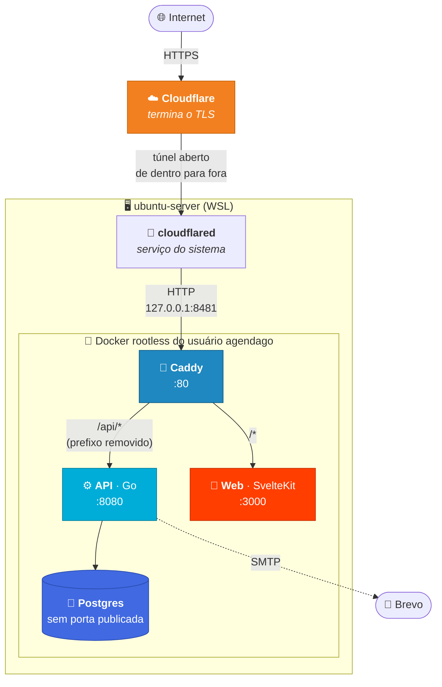
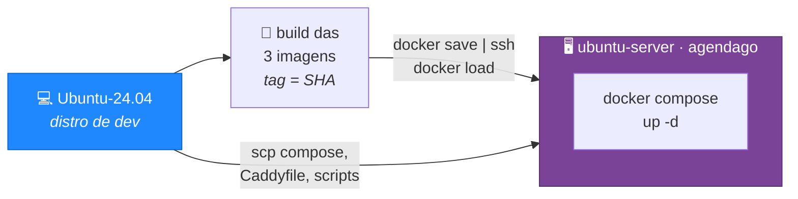
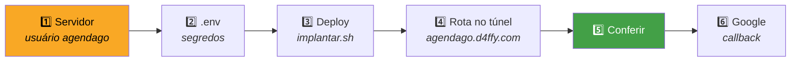
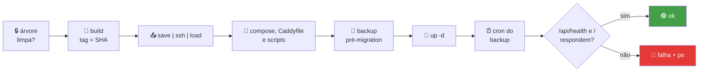

# 🚀 Produção

> Como o agendaGo vai para o ar, **na ordem em que as coisas precisam acontecer**.
> O servidor é a distro **`ubuntu-server`** do WSL desta mesma máquina, publicada
> por um **túnel da Cloudflare** — o mesmo servidor e o mesmo túnel do studygo.


| | |
|---|---|
| **Onde roda** | distro `ubuntu-server` do WSL, usuário `agendago`, Docker rootless |
| **Endereço** | `https://agendago.d4ffy.com` |
| **O que fica no servidor** | as imagens prontas + 3 arquivos — nunca o código-fonte |
| **Como atualiza** | `./scripts/implantar.sh`, da distro de desenvolvimento |
| **Quando está no ar** | com o PC ligado e a `ubuntu-server` de pé |

> [!NOTE]
> O `docker-compose.yml` da raiz é **só para desenvolvimento** (hot reload,
> portas expostas, Mailpit). Produção usa o **`docker-compose.prod.yml`**.

---

## 🏗️ Arquitetura no ar



**Nenhuma porta aberta para a internet.** O PC está atrás do roteador de casa,
sem IP fixo, e o WSL nem publica portas na rede local. Quem abre a conexão é o
`cloudflared`, de dentro para fora; a Cloudflare termina o HTTPS com o
certificado dela — não há Let's Encrypt para emitir nem renovar.

O Caddy continua na frente da aplicação, e serve **frontend e API na mesma
origem**: `/api/*` vai para a API (o prefixo é removido antes de repassar) e
todo o resto vai para o frontend. Ele escuta só em `127.0.0.1:8481` — a 8480 é
do nginx do studygo.

> [!IMPORTANT]
> **Origem única não é estética.** O cookie de sessão é `SameSite=Lax`, e é a
> origem única que faz o navegador enviá-lo de volta nas chamadas do front para
> a API — sem mudar código e sem CORS. Se front e API ficassem em domínios
> diferentes, **o login quebraria silenciosamente**. Essa decisão também é o que
> permite o frontend usar `/api` relativo, e a imagem não ficar amarrada a um
> domínio.

**O IP do visitante** vem do cabeçalho `CF-Connecting-IP`, que a Cloudflare
reescreve em toda requisição: o Caddy o repassa como `X-Real-IP` para a API, que
loga e limita por ele. Confiar no cabeçalho é seguro porque a porta do Caddy só
escuta em `127.0.0.1`, onde só o túnel chega. Sem isso, toda visita chegaria com
o IP do `cloudflared` — e o limite de tentativas de login valeria para o site
inteiro de uma vez.

### Por que Docker rootless, e um usuário só para o agendaGo

**Todas as distros do WSL2 dividem a mesma rede** — o mesmo IP, as mesmas
portas, o mesmo iptables. A distro de desenvolvimento roda o Docker do dia a
dia; um segundo Docker de sistema na `ubuntu-server` brigaria com ele pelo
`docker0` e pelo iptables. O Docker rootless de cada usuário tem rede própria
(slirp4netns), imagens e volumes próprios, e só publica as portas pedidas, em
localhost. O studygo roda no do usuário `studygo`; o agendaGo, no do
`agendago` — um não enxerga nem derruba o outro.

O `agendago` **não tem sudo**: o deploy só fala com o próprio Docker e escreve
no próprio home.

---

## 📦 O servidor não recebe o código-fonte



As imagens são buildadas na distro de desenvolvimento por
**`scripts/implantar.sh`** e entregues ao Docker do `agendago` por SSH. O
`docker-compose.prod.yml` só as consome — não tem nenhuma diretiva `build`, e
cada imagem da aplicação tem `pull_policy: never`. No servidor ficam:

```
/home/agendago/
├── agendago/
│   ├── 📄 docker-compose.prod.yml   ← sincronizado por implantar.sh
│   ├── 📄 Caddyfile                 ← sincronizado por implantar.sh
│   ├── 📁 scripts/                  ← backup, restore, rollback
│   └── 🔒 .env                      ← só lá. Nunca sai de lá
└── backups/                         ← dumps diários (cron)
```

> [!TIP]
> **Por que não buildar no servidor:** exigiria repositório e toolchain Go e
> Node lá dentro, e cada deploy compilaria competindo com o site no ar pela
> mesma VM do WSL (4 GB divididos entre as distros). Entregando a imagem
> pronta, o que roda em produção é **exatamente o artefato** que saiu daquele
> commit.

> [!IMPORTANT]
> **As imagens se chamam `localhost/agendago/agendago-*`.** Sem o prefixo
> `localhost/`, `agendago/agendago-api` seria um nome do Docker Hub — que
> qualquer um pode registrar, e que um `pull` acabaria baixando no lugar da
> imagem que faltou. Com ele, e com `pull_policy: never`, imagem ausente vira
> erro, nunca download.

---

# 🧭 Roteiro do primeiro deploy



A `ubuntu-server` em si — a distro, o sshd na 2222, o `cloudflared` com o
token do túnel e a tarefa do Windows que a mantém de pé — foi montada pelo
studygo (`~/studygo/docs/deploy.md` e `docs/cloudflare-tunnel.md` de lá). Este
roteiro parte dela pronta.

> [!CAUTION]
> **Não instale ufw, fail2ban nem o Docker de sistema na `ubuntu-server`.** A
> rede é a mesma da distro de desenvolvimento: um "deny by default" fecharia as
> duas, e um dockerd de sistema brigaria com o de lá. Nenhuma porta precisa
> abrir — o túnel só faz conexões de saída.

---

## 1️⃣ Preparar o servidor

Uma chave SSH só para o deploy do agendaGo, na distro de desenvolvimento:

```bash
ssh-keygen -t ed25519 -N '' -C 'agendago@ubuntu-server' -f ~/.ssh/agendago_servidor
```

E o usuário `agendago` no servidor, pelo SSH do administrador que já existe lá
(o `studygo`, que tem sudo):

```bash
ssh -i ~/.ssh/studygo_ci -p 2222 studygo@127.0.0.1 \
  sudo bash -s -- agendago "\"$(cat ~/.ssh/agendago_servidor.pub)\"" \
  < scripts/preparar-servidor.sh
```

O `scripts/preparar-servidor.sh` é idempotente e diz o que mudou:

| Faz | Por quê |
|---|---|
| garante `docker.io`, `docker-compose-v2`, `rootlesskit`, `uidmap`, `slirp4netns`, `cron`, `curl` | o rootless, o backup diário e a verificação do deploy |
| cria o `agendago`, **sem sudo**, só com a chave de deploy | o mínimo para subir a stack |
| `loginctl enable-linger agendago` | sem isso, o Docker do usuário morre no primeiro logout |
| instala o Docker rootless dele, **habilita** (`systemctl --user enable docker`) e liga | o linger só sobe o systemd do usuário; sem o `enable`, o Docker não volta quando a distro reinicia. Ver *Por que Docker rootless* acima |
| cria o contexto `rootless` como padrão | o SSH não interativo e o cron não leem o `.bashrc`; sem o contexto, `docker` procuraria o daemon de sistema, desligado |

**Confira:**

```bash
ssh -i ~/.ssh/agendago_servidor -p 2222 agendago@127.0.0.1 'systemctl --user is-enabled docker && docker context show && docker ps'
```

✅ `enabled`, `rootless` e uma lista (vazia) de containers.

---

## 2️⃣ O `.env` do servidor

O modelo é o `.env.prod.example`. Ele vai para `/home/agendago/agendago/.env`,
com `chmod 600` — tem a senha do banco, a do admin e as credenciais de SMTP e
OAuth:

```bash
ssh -i ~/.ssh/agendago_servidor -p 2222 agendago@127.0.0.1 \
  'mkdir -p ~/agendago && umask 077 && cat > ~/agendago/.env' < .env.prod.example
ssh -t -i ~/.ssh/agendago_servidor -p 2222 agendago@127.0.0.1 'nano ~/agendago/.env'
```

No mínimo: `DOMINIO`, `POSTGRES_PASSWORD`, `ADMIN_EMAIL`, `ADMIN_SENHA` e
`GOOGLE_REDIRECT_URL`. Senhas com `openssl rand -base64 24`.

> [!CAUTION]
> **O Compose lê o `.env` do diretório atual**, não do diretório onde está o
> arquivo de compose. Rodando de outro lugar, **todas** as variáveis chegam
> vazias — e nada diz *"faltou o .env"*. Os scripts fazem `cd ~/agendago`
> antes; à mão, faça o mesmo.

---

## 3️⃣ Deploy

Da raiz do repositório, na distro de desenvolvimento, com tudo commitado:

```bash
make test                 # sem esteira, ninguém mais roda os testes por você
./scripts/implantar.sh
```



| Decisão | Por quê |
|---|---|
| **Recusa árvore suja** | a tag é o SHA do commit, e é ela que o backup carimba e o rollback usa. Com alteração não commitada, a imagem levaria um SHA que não contém o que está nela |
| **Um `docker save` para as três** | as camadas em comum atravessam uma vez |
| **`latest` acompanha o deploy** | um `up -d` manual e o backup do cron enxergam a versão no ar |
| **Backup antes do `up`** | o cron das 03:00 sozinho deixaria o ponto de retorno mais recente na madrugada; não trava o primeiro deploy, quando a stack ainda não existe |
| **`IMAGE_TAG` pelo ambiente** | vence o `.env`, então sobrescreve um pin deixado pelo `rollback.sh` |
| **Verifica em `127.0.0.1:8481`, no próprio servidor** | um problema no túnel ou no DNS não reprova um deploy que subiu. API **e** página inicial — só a API deixaria passar um `web` quebrado |
| **Nunca toca no `.env`** | é lá que vivem os segredos |

Variáveis do script, todas com padrão: `SERVIDOR` (`agendago@127.0.0.1`),
`PORTA_SSH` (`2222`), `CHAVE_SSH` (`~/.ssh/agendago_servidor`), `PORTA_CADDY`
(`8481`) e `AGENDA_BACKUP` (`0 3 * * *`).

### 🔐 Usuário de banco sem poder de DDL

Por padrão a API se conecta com o **dono** do banco, que pode criar, alterar e
derrubar qualquer tabela — uma falha de execução remota na API herdaria esse
poder. O script abaixo cria um usuário só com `SELECT/INSERT/UPDATE/DELETE`.
Rode **uma vez**, com a stack no ar (é idempotente: rodar de novo só atualiza a
senha e reaplica os GRANTs). No servidor, como `agendago`:

```bash
cd ~/agendago
DB_PASSWORD=$(openssl rand -base64 24) ./scripts/criar-usuario-app.sh
```

O script imprime o que falta: acrescente ao `.env` e recrie a API.

```bash
# no .env
DB_USER=agendago_app
DB_PASSWORD=<a senha gerada acima>

docker compose -f docker-compose.prod.yml up -d api
```

> [!NOTE]
> Sem `DB_USER` no `.env`, a API continua usando o dono do banco — o
> comportamento antigo. Nada quebra por esquecer; só não se ganha a contenção.

Quem aplica migration continua sendo o dono, pelo Flyway. Para conferir que a
restrição pegou:

```bash
docker compose -f docker-compose.prod.yml exec -T postgres \
  psql -U agendago_app -d agendago -c "DROP TABLE providers;"
# ERROR: must be owner of table providers  ✅
```

---

## 4️⃣ Rota no túnel da Cloudflare

O túnel com token da `ubuntu-server` já existe (é o do studygo). O agendaGo é
só **mais uma rota** nele:

**[Cloudflare](https://dash.cloudflare.com) → Zero Trust → Networks → Tunnels →
o túnel → Routes** (nas versões antigas do painel, *Public Hostname*) **→ Add**:

| Campo | Valor |
|---|---|
| Subdomain | `agendago` |
| Domain | `d4ffy.com` |
| Type | `HTTP` |
| URL | `localhost:8481` |

A Cloudflare cria o registro DNS sozinha. Não há nada a mudar no servidor: o
`cloudflared` recebe a rota nova pelo próprio túnel.

> [!WARNING]
> **`HTTP`, não `HTTPS`.** O Caddy escuta HTTP puro em `127.0.0.1:8481`; o HTTPS
> é o da Cloudflare, entre o navegador e ela. Com `HTTPS` na rota o túnel tenta
> um handshake TLS que o Caddy não oferece, e a página vira **502**.

---

## 5️⃣ Conferir

No servidor:

```bash
docker compose -f docker-compose.prod.yml ps -a
```

| Serviço | Estado esperado |
|---|---|
| `postgres` | 🟢 Up (healthy) |
| `api` | 🟢 Up (healthy) |
| `web` | 🟢 Up (healthy) |
| `caddy` | 🟢 Up |
| `flyway` | ⚪ **Exited (0)** |

> [!NOTE]
> **`flyway` como *Exited* não é falha.** Ele é um job pontual que aplica as
> migrations e sai — **sair é o comportamento correto**. O `-a` no `ps` existe
> justamente para você conseguir enxergá-lo.

De qualquer lugar:

```bash
curl -s https://agendago.d4ffy.com/api/health        # {"status":"ok"}
curl -sI https://agendago.d4ffy.com/ | grep -iE 'strict-transport|content-security'
curl -so /dev/null -w '%{http_code}\n' https://agendago.d4ffy.com/api/swagger/index.html   # 404
```

> [!WARNING]
> **Use GET, não HEAD, no `/health`.** `curl -I` manda HEAD, e `/health` é
> registrada como `GET` — a resposta é **405**, que parece defeito e não é.

No navegador, confirme no DevTools que o cookie **`__Host-agendago_session`**
veio com **Secure**, **HttpOnly**, **SameSite=Lax**, `Path=/` e **sem Domain** —
o prefixo `__Host-` é justamente o contrato que exige esses atributos, e o
navegador ignora o cookie se algum faltar. Em desenvolvimento o nome é
`agendago_session`, sem prefixo: não há HTTPS, logo não há `Secure`.

Confirme também que as chamadas XHR vão para `https://agendago.d4ffy.com/api/...`
— nunca para `localhost:8080` — e que o **Console não acusa violação de CSP** em
nenhuma tela.

---

## 6️⃣ Login social com Google

No cliente OAuth do
[Google Cloud Console](https://console.cloud.google.com/apis/credentials)
(tipo *Web application*), cadastre:

| Campo | Valor |
|---|---|
| Authorized JavaScript origins | `https://agendago.d4ffy.com` |
| Authorized redirect URIs | `https://agendago.d4ffy.com/api/auth/google/callback` |

> [!CAUTION]
> **O `/api` é obrigatório.** O callback é rota da **API**, e atrás do Caddy a
> API vive sob esse prefixo. Sem ele, o Google devolve o usuário no frontend, que
> não tem essa rota: o consentimento funciona e **o login morre num 404** —
> depois de a conta já ter sido vinculada do lado do Google.

O Google compara a URL **caractere a caractere**; divergiu, recusa com
`redirect_uri_mismatch`. O mesmo cliente aceita várias URIs, então dev e
produção convivem:

| Ambiente | URI |
|---|---|
| Dev (API direta) | `http://localhost:8080/auth/google/callback` |
| Produção | `https://agendago.d4ffy.com/api/auth/google/callback` |

Com o app em modo *Testing* na tela de consentimento, só entram as contas
listadas em *Test users* (até 100); para abrir a todos, publique o app — o
escopo de login (`openid email profile`) não exige verificação do Google.

**Conferir sem abrir o navegador:**

```bash
curl -sD - -o /dev/null https://agendago.d4ffy.com/api/auth/client/google/start | grep -i location
```

---

## 7️⃣ Email

> [!CAUTION]
> **O remetente não pode ser `@gmail`/`@outlook`/`@yahoo`.** Quem envia é a
> Brevo, o DMARC desses provedores não a autoriza, e a mensagem cai em spam ou é
> rejeitada. É preciso um endereço de **domínio próprio** autenticado na Brevo
> (SPF + DKIM).
>
> Com o `d4ffy.com` na Cloudflare, os registros SPF e DKIM que a Brevo pedir
> entram no DNS de lá. Sem isso, confirmação de cadastro, recuperação de senha
> e cancelamento por link **não chegam de forma confiável**.

Credenciais SMTP ficam em **Brevo → SMTP & API → SMTP** (não é a senha da conta).

<details>
<summary><b>🧪 Testar email sem depender da entrega</b></summary>

<br>

**Validar as credenciais** sem disparar mensagem (`235` = aceitas):

```bash
U=$(printf '%s' "$SMTP_USER" | base64 -w0); P=$(printf '%s' "$SMTP_PASSWORD" | base64 -w0)
printf 'EHLO teste\r\nAUTH LOGIN\r\n%s\r\n%s\r\nQUIT\r\n' "$U" "$P" \
  | openssl s_client -quiet -starttls smtp -connect smtp-relay.brevo.com:587 2>/dev/null | grep '^235'
```

**Ver os emails que o app gera**, com um Mailpit no servidor:

```bash
docker run -d --name mailpit --network agendago_default -p 127.0.0.1:8025:8025 axllent/mailpit
SMTP_HOST=mailpit SMTP_PORT=1025 SMTP_STARTTLS=false SMTP_USER= SMTP_PASSWORD= \
  docker compose -f docker-compose.prod.yml up -d api
# caixa de entrada em http://localhost:8025
```

⚠️ **Zere `SMTP_USER` e `SMTP_PASSWORD` junto.** O Mailpit não faz AUTH, e a API
falha com `server does not support SMTP AUTH` se as credenciais continuarem lá.
A 8025 é a mesma do Mailpit de desenvolvimento — derrube um antes de subir o
outro.

</details>

---

# 🧪 Ensaiar na sua máquina antes

A stack de produção roda inteira na distro de desenvolvimento, sem túnel. Uma
pasta **fora do repositório**, com os mesmos três arquivos, deixa o comando
idêntico ao do servidor e o `.env` de desenvolvimento intocado:

```bash
cd ~/agendaGo
docker build -t localhost/agendago/agendago-api:latest        -f backend/Dockerfile.prod       backend/
docker build -t localhost/agendago/agendago-web:latest        -f frontend/Dockerfile.prod      frontend/
docker build -t localhost/agendago/agendago-migrations:latest -f backend/Dockerfile.migrations backend/

mkdir -p ~/agendago-ensaio && cd ~/agendago-ensaio
cp ~/agendaGo/docker-compose.prod.yml ~/agendaGo/Caddyfile .
cp ~/agendaGo/.env.prod.example .env
# no .env: DOMINIO=localhost:8491, PORTA_CADDY=8491 e senhas descartáveis
docker compose -f docker-compose.prod.yml up -d
# http://localhost:8491
```

O navegador trata `http://localhost` como contexto seguro: aceita o cookie
`Secure` sem HTTPS, então o login funciona no ensaio. Em qualquer outro host,
HTTP puro deixaria o site abrir e **ninguém conseguir logar** — sem mensagem de
erro.

> [!WARNING]
> **A porta do ensaio não pode ser a 8481.** As distros do WSL dividem a rede:
> a 8481 do ensaio e a do servidor são a mesma porta, e uma das stacks não sobe.

---

# 🛠️ Operação

<details>
<summary><b>🔄 Atualizar</b></summary>

<br>

Da distro de desenvolvimento, com o commit novo na árvore:

```bash
make test && ./scripts/implantar.sh
```

O Flyway aplica só as migrations novas; a API sobe depois. O desligamento é
gracioso (até 10s para as requisições em andamento terminarem), então o redeploy
**não derruba requests no meio**.

</details>

<details>
<summary><b>⏪ Rollback</b></summary>

<br>

O `implantar.sh` tagueia cada imagem com o SHA do commit, e o servidor guarda as
anteriores, então voltar código é trocar uma variável. Só dá para voltar para
um SHA que já passou por um deploy (`docker image ls localhost/agendago/agendago-api`
lista quais). **A pergunta que decide o caminho é uma só: houve migration entre as
duas versões?**

```
                    ┌─ não ─→  ./scripts/rollback.sh <sha-bom>
houve migration? ───┤
                    └─ sim ─→  ./scripts/restaurar.sh <backup> --sim-eu-quero
```

**Sem migration no meio** — segundos:

```bash
~/agendago/scripts/rollback.sh <sha-do-commit-bom>
~/agendago/scripts/rollback.sh latest   # volta a acompanhar o deploy
```

O script recusa o rollback quando o banco está à frente da imagem, que é a
quebra silenciosa que ele existe para impedir: o `up -d` subiria sem erro e o
defeito só apareceria no primeiro `INSERT`, com usuário na frente.

**Com migration no meio** — o Flyway é forward-only e não desfaz. O caminho é
restaurar o backup carimbado, que já traz de volta a imagem que o gerou:

```bash
~/agendago/scripts/restaurar.sh                    # mostra o que vai fazer, sem executar
~/agendago/scripts/restaurar.sh <arquivo> --sim-eu-quero
```

Antes de sobrescrever, ele grava um backup do estado ATUAL — se restaurar for a
decisão errada, esse é o caminho de volta.

> [!TIP]
> **O melhor rollback é o que não precisa do banco.** Migration que aperta
> (`SET NOT NULL`, `DROP COLUMN`) exige dois deploys — ver a regra no `CLAUDE.md`
> e o ciclo em `docs/tecnologias.md`. Respeitada, todo rollback cai no caminho
> curto.

Para ensaiar os dois caminhos sem tocar em produção:

```bash
./scripts/testar-rollback.sh
```

</details>

<details>
<summary><b>📋 Logs</b></summary>

<br>

Em produção a API emite **JSON estruturado** em stdout, com rotação já
configurada (3 arquivos de 10 MB por serviço).

```bash
docker compose -f docker-compose.prod.yml logs -f api                          # acompanhar
docker compose -f docker-compose.prod.yml logs api | jq 'select(.level=="ERROR")'   # só erros
docker compose -f docker-compose.prod.yml logs api | jq 'select(.level=="WARN")'    # segurança
```

Cada requisição gera uma linha com `request_id`, `rota` (o **padrão**, não o
caminho — tokens não vão para o log), `status`, `duracao` e `ip` do cliente real
(resolvido do `X-Real-IP` que o Caddy define). O mesmo `request_id` liga a linha
de acesso ao erro correspondente.

</details>

<details>
<summary><b>💾 Backup</b></summary>

<br>

O script `scripts/backup.sh` é **versionado e sincronizado pelo `implantar.sh`**
— chega em `~/agendago/scripts/backup.sh` a cada deploy. Ele faz um dump lógico completo,
comprime, **verifica a integridade**, **pula backups idênticos** e aplica rotação.

```bash
~/agendago/scripts/backup.sh
```

> [!TIP]
> **O agendamento é instalado pelo próprio deploy.** O `implantar.sh` registra
> a entrada no crontab do usuário `agendago` de forma idempotente — reescreve só a
> linha do agendaGo e preserva qualquer outra tarefa. Não há passo manual: um
> cron esquecido não avisa, e a descoberta viria no dia em que o backup fosse
> necessário.

Para mudar o horário, rode o deploy com **`AGENDA_BACKUP`**, por exemplo
`AGENDA_BACKUP='30 4 * * *' ./scripts/implantar.sh`. O padrão é `0 3 * * *`.

> [!CAUTION]
> **A expressão é interpretada no fuso do servidor** — a `ubuntu-server` está
> em `America/Sao_Paulo`, mas uma distro nova costuma vir em `Etc/UTC`. O cron do Debian/Ubuntu (`3.0pl1`) **não suporta `CRON_TZ`** —
> verificado no binário —, então não há como declarar o fuso dentro do crontab.
> Num host em UTC, `0 1 * * *` dispara às **22h de Brasília**.
>
> Se precisar acertar o fuso, uma vez, como root:
>
> ```bash
> timedatectl set-timezone America/Sao_Paulo
> ```
>
> Além do cron, isso alinha todos os horários que você lê no servidor com o seu
> relógio — e com o fuso fixo que a aplicação já assume nas regras de negócio.
> O Postgres e os containers continuam em UTC internamente, como deve ser.
>
> O deploy imprime o fuso do servidor ao lado da linha instalada, justamente
> para esse desencontro nunca passar despercebido:
>
> ```
> fuso do servidor: America/Sao_Paulo (agora: 2026-07-26 00:33:38 -03)
> crontab: 0 1 * * * $HOME/agendago/scripts/backup.sh >> ...
> ```

> [!WARNING]
> Como o crontab passa a ser gerenciado pelo deploy, **editar a linha do
> agendaGo à mão no servidor não adianta** — o próximo deploy a reescreve. Mude
> pela variável.

Variáveis opcionais do script: `PASTA_BACKUP` (padrão `~/backups`),
`RETENCAO_DIAS` (padrão `7`) e `URL_HEARTBEAT` (sem padrão — ver abaixo).

### Quem avisa que o backup parou

O script termina pingando `URL_HEARTBEAT`, se ela estiver definida. **O alerta
nasce da ausência do ping**, não da presença de um erro — e é isso que resolve o
problema do "cron esquecido não avisa": um cron desativado, um PC desligado e
um dump que falhou produzem exatamente o mesmo silêncio, e os três merecem
alerta.

Por isso o ping é a última linha do script: com `set -e`, qualquer falha acima
encerra a execução antes de chegar nele. Falhar o ping em si **não** reprova o
backup — o arquivo já está gravado, e derrubar o script nesse ponto só produziria
um erro sem nada a corrigir.

Serve qualquer monitor de *heartbeat* (Uptime Kuma no modo "push", Healthchecks.io,
Better Stack). Configure a janela esperada com folga sobre o horário do cron.

> [!IMPORTANT]
> O monitor precisa rodar **fora desta máquina**. Se ele mora no mesmo PC, a queda
> da máquina leva junto quem deveria avisar — vale para o heartbeat do backup e
> para a sonda de `/ready`.

### Por que full, e não incremental

| Estratégia | No Postgres | Veredito |
|---|---|---|
| **Full** (`pg_dump`) | dump lógico completo | ✅ **usado aqui** |
| **Incremental** | `pg_basebackup` + arquivamento de WAL (PITR) | complexidade sem ganho nesta escala |
| **Diferencial** | não existe nativamente; só via restic/borg sobre o data dir | exige snapshot consistente |

O banco é pequeno — um dump completo leva segundos e ocupa dezenas de KB. Mais
importante: **a restauração é um comando só**, e é isso que importa no dia em que
ela for necessária. Dump lógico ainda sobrevive a upgrade de versão maior do
Postgres e restaura em outra máquina, o que backup físico não faz.

O preço é um RPO de 24h: na pior hipótese, perde-se um dia de agendamentos.
Quando isso deixar de ser aceitável — ou o banco passar de alguns GB —, o caminho
é WAL archiving com [pgBackRest](https://pgbackrest.org/) ou
[barman](https://pgbarman.org/).

### Dia sem alteração não gera backup novo

O script calcula o **SHA-256 do conteúdo** do dump e o guarda num arquivo
`.sha256` ao lado. Se o hash bater com o do backup anterior, nenhum arquivo novo
é criado — só uma linha no log:

```
2026-07-26 03:00:02  sem alteração desde agendago-2026-07-25-030001.sql.gz; nenhum backup novo criado
```

Dois detalhes fazem isso funcionar:

> [!WARNING]
> **O `pg_dump` não é reprodutível byte a byte.** Ele envolve o dump em
> `\restrict`/`\unrestrict` com um **token aleatório** a cada execução — proteção
> contra injeção de meta-comandos do `psql`. Dois dumps do mesmo banco intocado
> têm hashes diferentes se você não descartar essas linhas antes de calcular.

> [!CAUTION]
> **Quando pula, o script dá `touch` no backup anterior.** Sem isso, um banco
> parado por mais tempo que a retenção teria seu último backup apagado pela
> rotação — e você terminaria com **zero backups**. Como consequência, a data no
> nome do arquivo deixa de indicar quando o backup rodou; essa informação passa a
> viver no log.

Uma ressalva sobre o sentido do erro: a ordem das linhas do `COPY` acompanha a
ordem física das tuplas, que muda com `UPDATE` e `VACUUM`. O hash pode então
diferir sem mudança lógica — gerando um backup a mais, o que é inofensivo. O
inverso (dados diferentes com o mesmo hash) não acontece.

O `.sha256` tem um segundo uso, mais valioso que a deduplicação: **verificar
corrupção silenciosa** do arquivo com o tempo, e conferir se a cópia enviada para
fora do servidor chegou íntegra.

> [!CAUTION]
> **Backup que mora só no servidor morre com ele.** A `ubuntu-server` é um
> disco virtual dentro do Windows: se ele corromper, ou a distro for
> reinstalada, os sete dumps vão junto. Puxe uma cópia para fora — por
> exemplo, para o disco do Windows, a partir da distro de desenvolvimento:
>
> ```bash
> rsync -avz -e "ssh -i ~/.ssh/agendago_servidor -p 2222" \
>   agendago@127.0.0.1:backups/ /mnt/c/Users/sousa/agendago-backups/
> ```
>
> E lembre que o dump tem **email e telefone de pessoas reais** — o script já
> aplica `chmod 600`, mas fora do servidor a proteção é sua.

### Testar a restauração

> [!IMPORTANT]
> **Backup nunca restaurado é só um arquivo com esperança dentro.** Verificar a
> integridade do dump prova que o arquivo não saiu truncado — não prova que ele
> volta. São coisas diferentes, e só a segunda importa no dia em que importa.

O `scripts/testar-restore.sh` faz isso sozinho, e também é versionado e
sincronizado pelo `implantar.sh`:

```bash
~/agendago/scripts/testar-restore.sh              # o backup mais recente
~/agendago/scripts/testar-restore.sh caminho.gz   # um arquivo específico
```

Ele confere o `.sha256`, sobe um Postgres descartável **com o mesmo papel de
produção** (o dump traz `OWNER TO`, e restaurar sob outro nome falha com `role
does not exist`), restaura com `ON_ERROR_STOP=1`, verifica que as tabelas do
domínio existem, que o histórico do Flyway veio junto e que **o manifesto não
mente** sobre a versão do dump, e destrói o container ao final:

```
2026-07-28 09:14:02  testando o restore de agendago-2026-07-28-030001-schema19.sql.gz
2026-07-28 09:14:02  hash confere
2026-07-28 09:14:09  restaurando
2026-07-28 09:14:10  manifesto confere: schema V19, imagem 3328e02
2026-07-28 09:14:10  ok: restore íntegro — 19 migrations, 4 prestador(es), 27 agendamento(s)
```

### O carimbo de versão

Cada backup vem com um `.json` ao lado do `.sha256`, e a versão do schema entra
no nome do arquivo:

```json
{
  "arquivo": "agendago-2026-07-28-030001-schema19.sql.gz",
  "criado_em": "2026-07-28T03:00:01-03:00",
  "schema_version": "19",
  "image_tag": "3328e02…",
  "sha256": "…"
}
```

É o que fecha o ciclo com o rollback: sem ele, descobrir a que versão do código
um dump pertence exige restaurá-lo e ler o `flyway_schema_history` — arqueologia
no meio de um incidente. Com ele, `restaurar.sh` sobe de volta o **par** que
funcionava junto, sem ninguém precisar lembrar qual imagem era.

Por isso a deduplicação olha três coisas, não só o hash do conteúdo: dado
idêntico sob um schema ou uma imagem nova merece ponto de restauração próprio —
é justamente o retrato pré-migration que o rollback vai querer.

Nada disso toca a produção: o container é próprio, sem porta publicada, e some no
fim. O `ON_ERROR_STOP=1` não é detalhe — sem ele o `psql` segue depois de um erro
e ainda termina com status 0, o que faria um restore quebrado passar por bom.

Rode ao menos uma vez, e sempre que mudar algo no processo de backup.

⚠️ **Exportar a distro (`wsl --export`) não substitui isto.** Ela restaura a
máquina inteira — serve para desastre, não para "recuperar o banco de ontem" nem
para levar os dados para outro lugar.

</details>

<details>
<summary><b>🔐 Certificado</b></summary>

<br>

Não há nenhum no servidor: o HTTPS é o da Cloudflare, que emite e renova o
certificado de `agendago.d4ffy.com` sozinha. O Caddy fala só HTTP, em
`127.0.0.1`.

</details>

<details>
<summary><b>🔌 Ligar, desligar e o túnel</b></summary>

<br>

O site só fica no ar **com o PC ligado e a `ubuntu-server` de pé**. A tarefa
agendada do Windows criada pelo studygo (`studygo-servidor`) mantém a distro
acordada a partir do logon; com a distro de pé, o `docker` rootless do
`agendago` sobe sozinho — o linger sobe o systemd do usuário e o serviço
`docker` **habilitado** sobe com ele — e os containers voltam pelo
`restart: unless-stopped`.

| Sintoma | Causa provável | O que fazer |
|---|---|---|
| 502 da Cloudflare | o túnel chegou ao servidor, mas o Caddy não respondeu | `docker compose -f docker-compose.prod.yml ps -a` no servidor; confira se a rota é `HTTP` → `localhost:8481` |
| 1033 / túnel indisponível | o `cloudflared` caiu ou a distro está parada | `wsl.exe -l -v`; no servidor, `systemctl status cloudflared` (pelo usuário `studygo`, que tem sudo) |
| Nada responde, nem em `127.0.0.1:8481` | o Docker do `agendago` não está de pé — se aparece `disabled`, ele não volta sozinho depois que a distro reinicia | `systemctl --user status docker`, como `agendago`; se estiver `disabled`, `systemctl --user enable --now docker` |

O `cloudflared` e o token do túnel pertencem ao servidor, não a este
repositório: são montados pelo Ansible do studygo
(`~/studygo/docs/cloudflare-tunnel.md`).

</details>

---

# 📊 Dimensionamento

> Medições reais da stack de produção, com os containers **limitados a 2 vCPUs**
> e o banco vazio.

| Rota | Req/s | p50 | p99 |
|---|---:|---:|---:|
| `/api/health` | **12.235** | 3,5 ms | 15,6 ms |
| `/api/providers` (Postgres) | **4.665** | 8,7 ms | 1,55 s |
| `/` (página do frontend) | **2.749** | 15,5 ms | 233 ms |
| `/auth/provider/login` (Argon2id) | **85** | 226 ms | 544 ms |

**Memória em repouso — 99 MiB nos quatro containers:**

| Container | RAM |
|---|---:|
| 🐘 Postgres | 41 MiB |
| 🎨 Web | 26 MiB |
| ⚙️ API | 18 MiB |
| 🔐 Caddy | 13 MiB |

> [!IMPORTANT]
> **O gargalo é o login.** Cada verificação Argon2id custa ~24 ms de CPU e
> **19 MB de RAM**, de propósito — é o que torna quebra de senha por força bruta
> cara. Sob 20 logins simultâneos, a API sozinha chegou a **365 MiB**. Num host
> de 1 GB isso pede swap; com 4 GB não é preocupação. O rate limit por IP existe
> exatamente para conter esse pico.

Na `ubuntu-server`, logo após o primeiro deploy, a stack ocupou **~240 MiB**
(o `web` é o maior, ~110 MiB). A VM do WSL tem 4 GB divididos entre a distro de
desenvolvimento, o studygo e o agendaGo — os `mem_limit` do compose são o teto
que impede um deles de tomar a memória dos outros. Como o servidor não compila
nada, o pico de RAM do build fica na distro de desenvolvimento.

---

# ✅ Checklist de go-live

- [ ] **`APP_ENV=production`** — já fixado no compose; liga `Secure` e o prefixo `__Host-` no cookie
- [ ] **Rota do túnel** — `agendago.d4ffy.com` → `HTTP` → `localhost:8481`, e `curl https://agendago.d4ffy.com/api/health` responde
- [ ] **Rate limit > 0** — nenhum `RATE_LIMIT_*` pode ser `0` (são cinco: IP, conta e sessão)
- [ ] **`ADMIN_SENHA` e `POSTGRES_PASSWORD` fortes** — `openssl rand -base64 24`
- [ ] **`DB_USER` sem DDL** — `scripts/criar-usuario-app.sh` rodado e `DB_USER`/`DB_PASSWORD` no `.env`
- [ ] **`.env` com `chmod 600`**
- [ ] **SMTP com remetente de domínio autenticado** — se já usou a chave em outro lugar, **rotacione**
- [ ] **SMTP funcionando de verdade** — sem email, ninguém mais cria conta: prestador **e** cliente dependem do link de confirmação
- [ ] **Nenhuma porta fora de `127.0.0.1`** — o compose só publica a do Caddy, em localhost
- [ ] **Swagger fora do ar** — duas camadas: a API não monta a rota em produção **e** o Caddy responde 404
- [ ] **CSP e cabeçalhos de segurança** — `curl -I https://agendago.d4ffy.com` mostra `content-security-policy`, `strict-transport-security`, `permissions-policy` e `cross-origin-opener-policy`
- [ ] **Sem violação de CSP no Console** — abra painel, admin e a página pública de agendamento
- [ ] **Backup do banco agendado**

---

# 🚨 Armadilhas conhecidas

> Compilado do que quebrou **de verdade**, para consulta rápida.

| Sintoma | Causa |
|---|---|
| `405` no `/api/health` | `curl -I` manda HEAD; a rota é `GET` |
| `flyway` como *Exited* | ✅ é o esperado: job pontual que roda e sai |
| Variáveis vazias no compose | rodou de fora da pasta que contém o `.env` |
| `pull access denied` / imagem não encontrada | a imagem não está no Docker do `agendago`: rode o `implantar.sh` (as imagens nunca vêm de registry) |
| `implantar.sh` recusa rodar | há alteração não commitada — a tag seria um SHA que não contém o que está na imagem |
| 502 da Cloudflare | rota do túnel com `HTTPS` em vez de `HTTP`, ou a stack fora do ar |
| `docker` não acha o daemon por SSH ou cron | falta o contexto `rootless` como padrão — rode o `preparar-servidor.sh` de novo |
| Login social em 404 após consentimento | `GOOGLE_REDIRECT_URL` sem o prefixo `/api` |
| `redirect_uri_mismatch` | URL não cadastrada, ou diferente, no Google Console |
| Chave SSH ignorada sem erro claro | permissões frouxas em `~/.ssh` ou `authorized_keys` |
| `sudo` falha para o `agendago` | 🔒 intencional: o usuário de deploy não tem sudo |
| API não sobe, erro de parse de URL | senha do banco com caractere reservado — *corrigido: DSN montada com `net/url`* |
| Frontend chamando `localhost:8080` | `PUBLIC_API_URL` não exposta no build — *corrigido: `envPrefix` no `vite.config.ts`* |

---

<details>
<summary><b>📖 Referência: variáveis de ambiente</b></summary>

<br>

| Variável | Obrigatória | Padrão | Para quê |
|---|---|---|---|
| `DOMINIO` | ✅ | — | hostname público (a rota do túnel); vira `FRONTEND_ORIGIN` e a origem do frontend |
| `PORTA_CADDY` | — | `8481` | porta do Caddy em `127.0.0.1`, para onde a rota do túnel aponta |
| `IMAGE_REPO` | — | `localhost/agendago` | prefixo das imagens no Docker do servidor |
| `IMAGE_TAG` | — | `latest` | versão das imagens (`rollback.sh` fixa um SHA aqui) |
| `POSTGRES_DB/USER/PASSWORD` | ✅ | — | banco (a API recebe como `DB_*`) |
| `APP_ENV` | ✅ | `production` (fixo) | liga `Secure` no cookie, log em JSON e **remove a rota do Swagger** |
| `FRONTEND_ORIGIN` | ✅ | `https://${DOMINIO}` (fixo) | origem no CORS e base dos links dos emails |
| `ADMIN_EMAIL/SENHA` | recomendado | — | semeiam o admin no boot (vazias = sem admin) |
| `DB_USER` | recomendado | dono do banco | usuário da API; use o criado por `scripts/criar-usuario-app.sh` (só DML) |
| `DB_PASSWORD` | se usar `DB_USER` | senha do dono | senha desse usuário |
| `RATE_LIMIT_LOGIN_POR_MINUTO` | — | `10` | teto de logins por IP/min (⚠️ **não use 0**) |
| `RATE_LIMIT_CONVIDADO_POR_MINUTO` | — | `10` | teto de agendamentos de convidado por IP/min |
| `RATE_LIMIT_PUBLICO_POR_MINUTO` | — | `60` | teto das leituras públicas (vitrine, slots) por IP/min |
| `RATE_LIMIT_LOGIN_POR_CONTA` | — | `5` | falhas de login/pedidos de recuperação por **conta** a cada 5 min |
| `RATE_LIMIT_AUTENTICADO_POR_MINUTO` | — | `60` | teto de escritas por **sessão**/min |
| `SMTP_HOST` | — | — | servidor SMTP. **Vazio desliga o envio** |
| `SMTP_PORT` | — | `587` | porta SMTP |
| `SMTP_USER/PASSWORD` | — | — | credenciais SMTP |
| `SMTP_STARTTLS` | — | `true` | exige STARTTLS |
| `EMAIL_REMETENTE/_NOME` | — | — | remetente (precisa ser de domínio autenticado) |
| `EMAIL_REPLY_TO` | — | — | endereço de resposta |
| `GOOGLE_CLIENT_ID/SECRET` | — | — | login social; **vazio desliga** o recurso |
| `GOOGLE_REDIRECT_URL` | se usar Google | — | callback **com o prefixo `/api`** |

</details>
